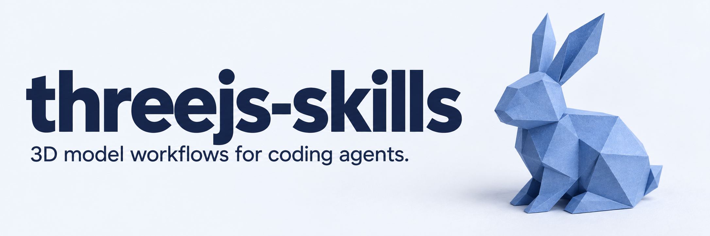

Agent skills for three.js, React Three Fiber and web 3D. They are built around the everyday work of getting a 3D
model on screen and keeping it right: what is inside the file, why it renders black, how to make it smaller without
breaking the code that uses it, how to play its clips and change its parts. They also cover scroll stories, physics,
Gaussian splats, WebXR and `<model-viewer>`.

The model skills do not just describe: they run code and look at the result. One script reports what a model
contains, another renders it from six angles, and a third diffs before and after. A linter catches outdated three.js
APIs, and a scene doctor profiles a running app.

Everything targets three r186 (the current release), React Three Fiber 9 and drei 10. Every API reference in every
skill is checked against those packages by `pnpm check`.

## Install

With the [skills](https://skills.sh) CLI, for any supported agent (it asks which ones):

```bash
npx skills@1 add emiliodominguez/threejs-skills
```

Per agent, user-wide (`--global`) or into the current project (omit it):

```bash
npx skills@1 add emiliodominguez/threejs-skills --agent claude-code --global --yes   # ~/.claude/skills
npx skills@1 add emiliodominguez/threejs-skills --agent codex --global --yes         # ~/.agents/skills
```

As a plugin: Claude Code reads `.claude-plugin/`, Codex reads `.codex-plugin/` and `.agents/plugins/marketplace.json`:

```bash
claude plugin marketplace add emiliodominguez/threejs-skills
codex plugin marketplace add emiliodominguez/threejs-skills && codex plugin add threejs-skills@threejs-skills
```

By profile with the wrapper script from a checkout. It installs user-wide by default; flags after `--` go to every
`npx skills add` call, including img2threejs:

```bash
./install.sh --profile models                       # model workflow, scene doctor, upgrade linter, router
./install.sh --profile experiences                  # scroll, physics, WebXR, splats, model-viewer
./install.sh --profile foundations                  # three.js fundamentals through performance
./install.sh --profile create --with-img2threejs    # assets, generation, plus the external img2threejs skill
./install.sh --local --project -- --agent codex --yes   # this checkout into the project you run it from
```

Runtime requirements: Node 22+ for the scripts; a Chrome-family browser for rendering and the scene doctor (or
`npx playwright install chromium`); `npx` with network access for `optimize.mjs`; Blender for format conversion;
`TRIPO_API_KEY` for generation; `SKETCHFAB_TOKEN` for Sketchfab downloads.

## Skills

### Models

| Skill                     | What it does                                                                                                                                                                                           |
| ------------------------- | ------------------------------------------------------------------------------------------------------------------------------------------------------------------------------------------------------ |
| `threejs`                 | Router: maps a task to the right skill, checks the stack (vanilla or R3F) and the three version.                                                                                                       |
| `threejs-model-inspect`   | Reports names (as three.js will see them), clips, bones, bounds, bytes, GPU memory, decoders and ranked findings. Renders six-view contact sheets and before/after pixel diffs. Converts FBX and OBJ.  |
| `threejs-model-fix`       | Symptom-to-fix guide for vanilla and R3F (black, invisible, huge, off-center, inside-out, washed out, loader errors), checked against a known-good reference viewer.                                   |
| `threejs-model-optimize`  | Presets over `gltf-transform optimize` (`web`, `hero`, `configurator`, `animated`, `background`, `mobile`, `lossless`) with a before/after report that flags node and material names the pass removed. |
| `threejs-model-animate`   | Clips, crossfades, one-shots, layered and additive clips, rigged copies, morph targets, Mixamo clips, root motion and retargeting.                                                                     |
| `threejs-model-customize` | Per-part colors and materials without leaking into shared materials, texture swaps, `KHR_materials_variants`, click picking, attachments.                                                              |
| `threejs-scene-doctor`    | Profiles a running app with no code changes (it uses three.js's devtools hook): draw calls, leaks, missing lights, color spaces, stuck mixers.                                                         |
| `threejs-upgrade`         | Linter for outdated three.js and R3F code, with release numbers, `--fix` for safe renames, and a guide to the migrations that need judgment.                                                           |

### Experiences

| Skill                | What it does                                                                                                         |
| -------------------- | -------------------------------------------------------------------------------------------------------------------- |
| `threejs-scroll`     | Scroll-driven camera paths, reveals and clip scrubbing with GSAP ScrollTrigger or drei ScrollControls.               |
| `threejs-physics`    | Rapier: colliders from glTF meshes, fixed-step loops, events, character controllers, `@react-three/rapier`.          |
| `threejs-splats`     | Gaussian splats with Spark: formats, orientation, mixing with meshes, LOD, editing.                                  |
| `threejs-webxr`      | AR placement with hit testing, VR sessions, controllers and hands, `@react-three/xr` 6.                              |
| `web3d-model-viewer` | `<model-viewer>` product embeds with AR, hotspots, variants and material edits, and when to choose it over three.js. |

### Create

| Skill                                                                  | What it does                                                                                                                  |
| ---------------------------------------------------------------------- | ----------------------------------------------------------------------------------------------------------------------------- |
| `threejs-assets`                                                       | Searches and downloads from Poly Haven and Sketchfab, writing `CREDITS.json` and `CREDITS.md` with each asset's license.      |
| `threejs-model-generate`                                               | Text-to-3D and image-to-3D through the Tripo API, with rigging, retargeting and conversion. Confirms before spending credits. |
| [`img2threejs`](https://github.com/img2threejs/img2threejs) (external) | Rebuilds an object from a photo as procedural three.js code. Installed with `--with-img2threejs`.                             |

### Foundations

`threejs-fundamentals`, `threejs-geometry`, `threejs-materials`, `threejs-lighting`, `threejs-textures`,
`threejs-loaders`, `threejs-animation`, `threejs-interaction`, `threejs-shaders`, `threejs-postprocessing`,
`threejs-performance`, `threejs-react-three-fiber` and `threejs-asset-pipeline`: current-API references with WebGPU
and TSL sections and Common Mistakes lists of outdated patterns.

## Scripts

Every bundled script runs with plain `node` and installs nothing:

```bash
node skills/threejs-model-inspect/scripts/inspect.mjs model.glb                     # what is inside
node skills/threejs-model-inspect/scripts/render.mjs model.glb                      # six-view contact sheet
node skills/threejs-model-inspect/scripts/render.mjs a.glb --compare b.glb          # A, B and a pixel diff
node skills/threejs-model-optimize/scripts/optimize.mjs model.glb --preset configurator
node skills/threejs-scene-doctor/scripts/doctor.mjs http://localhost:5173           # profile a running app
node skills/threejs-upgrade/scripts/lint.mjs src --fix                              # outdated three.js APIs
node skills/threejs-assets/scripts/fetch.mjs search polyhaven chair
```

## How it is kept correct

- `pnpm check`: formatting, skill validation (frontmatter, description budgets, references, profiles, manifests),
  `check:api` (1,300+ API references in skills and examples resolved against the pinned three, drei, fiber, Rapier,
  XR, Spark and GSAP), and the test suite.
- `pnpm examples`: eight runnable examples, one per main recipe, rendered headlessly and checked for console
  errors, their own behavioral checks (a part recolored alone, bodies came to rest, the camera followed scroll) and
  lit, visible pixels. `pnpm examples:all` adds network-only ones.
- `evals/`: a collection of broken models (black metal, centimeter scale, mirrored, missing normals, 8k textures,
  spec-gloss, missing files, converter clip names, variants) that inspect must diagnose, and agent tasks graded by
  rendering the agent's page. `pnpm eval --task fix-black` runs an agent with and without the skills.
- `pnpm upstream`: compares the target release with npm and the migration guide (including releases still in
  development), flags skill files that mention changed APIs, checks documented library versions, and syncs forked
  skills with `--sync`.

## Development

```bash
pnpm install
pnpm check
pnpm examples
```

## Credits

The foundation skills are forked from [cloudai-x/threejs-skills](https://github.com/cloudai-x/threejs-skills) and
`threejs-model-generate` from [majidmanzarpour/threejs-game-skills](https://github.com/majidmanzarpour/threejs-game-skills),
both MIT. See [THIRD_PARTY_NOTICES.md](THIRD_PARTY_NOTICES.md). Sample models used during development come from the
[Khronos glTF Sample Assets](https://github.com/KhronosGroup/glTF-Sample-Assets). The README banner was generated with
Codex.

## License

MIT
